<div align="center">

<a href="https://github.com/sadult/umbra">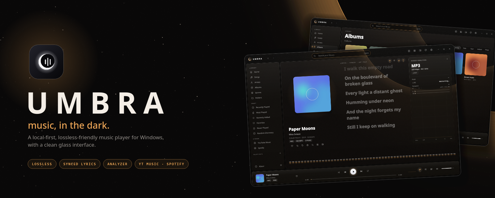</a>

<br>
<br>

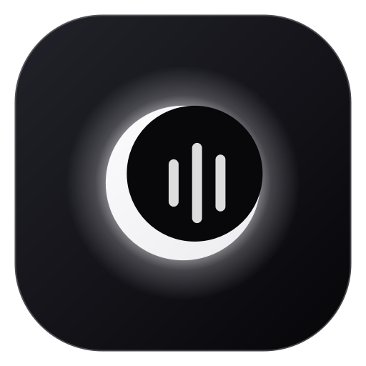

<h1>Umbra</h1>

<p><b>music, in the dark.</b></p>
<p>A local-first, lossless-friendly music player for Windows<br>with a calm, dark, glass interface.</p>

<!-- release & downloads -->
<a href="https://github.com/sadult/umbra/releases/latest"></a>
<a href="https://github.com/sadult/umbra/releases"></a>
<a href="https://github.com/sadult/umbra/actions/workflows/build.yml"></a>

<br>

<!-- code -->


<br>

<!-- community -->
<a href="https://github.com/sadult/umbra/stargazers"></a>
<a href="https://github.com/sadult/umbra/network/members"></a>
<a href="https://github.com/sadult/umbra/issues"></a>
<a href="https://github.com/sadult/umbra/commits/main"></a>
<a href="https://github.com/sadult/umbra/commits/main"></a>
<a href="LICENSE"></a>
<a href="CONTRIBUTING.md"></a>


<br>
<br>

<a href="https://github.com/sadult/umbra/releases/latest"></a>

<br>
<br>

<a href="#-highlights">Highlights</a> ·
<a href="#-screenshots">Screenshots</a> ·
<a href="#-features">Features</a> ·
<a href="#-install">Install</a> ·
<a href="#-keyboard-shortcuts">Shortcuts</a> ·
<a href="#-faq">FAQ</a> ·
<a href="#-roadmap">Roadmap</a> ·
<a href="#-contributing">Contributing</a>

</div>

<br>

## ✦ Highlights

<table>
<tr>
<td width="33%" valign="top">

### 🎧 Sound first
64-bit float engine, gapless playback, crossfade, 10-band EQ, WASAPI exclusive mode and a real audio analyzer with LUFS, true peak and dynamic range.

</td>
<td width="33%" valign="top">

### 🎤 Lyrics, solved
Synced lyrics from `.lrc`, tags or LRCLIB. **One click fetches lyrics for your entire library.** Search online and add when automatic matching misses.

</td>
<td width="33%" valign="top">

### ☁️ Your playlists, offline
Import Spotify and YouTube playlists, stream them, **sync** them later and **download** them as tagged files that replace the streams automatically.

</td>
</tr>
</table>

## ✦ Screenshots

<div align="center">

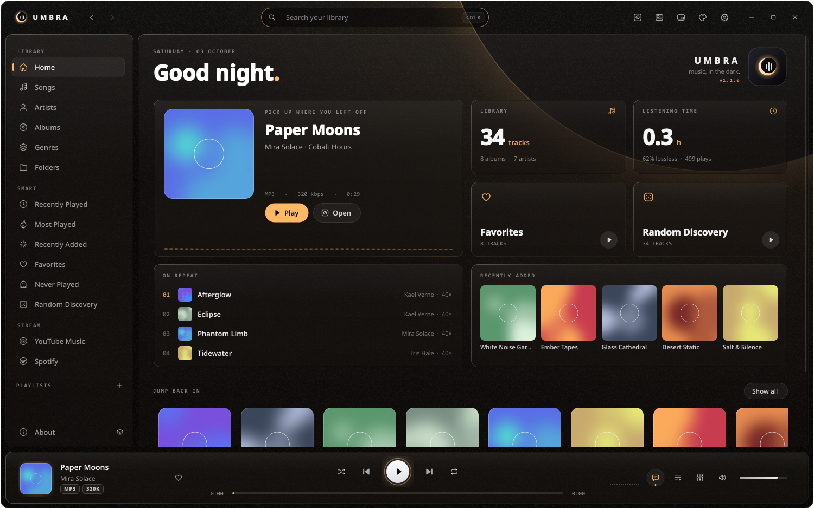
<p><sub><b>Home</b> — what you're playing, your library at a glance and what's on repeat.</sub></p>

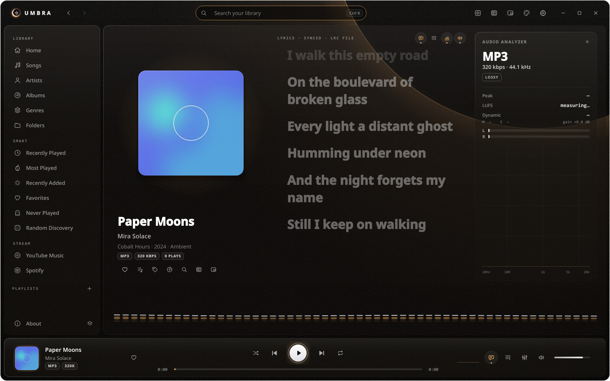
<p><sub><b>Now Playing</b> — synced lyrics, live analyzer and visualizer.</sub></p>

<table>
<tr>
<td width="50%" align="center">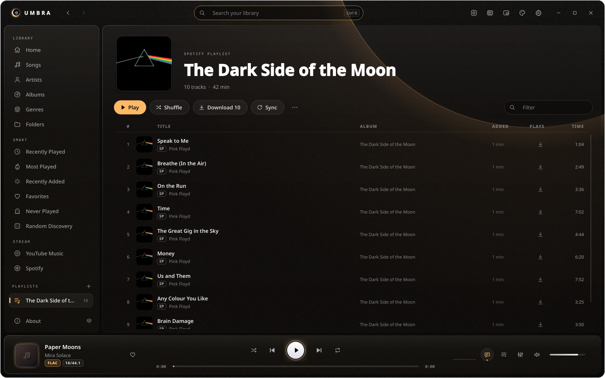<br><sub><b>Spotify playlist</b> — stream, sync or download</sub></td>
<td width="50%" align="center">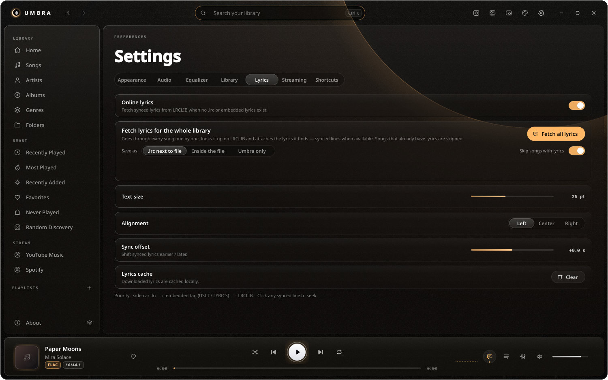<br><sub><b>Fetch all lyrics</b> for the whole library</sub></td>
</tr>
<tr>
<td align="center">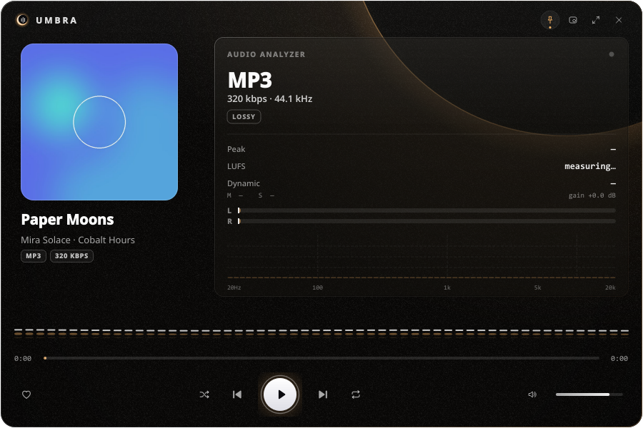<br><sub><b>Small player</b> with analyzer & visualizer</sub></td>
<td align="center">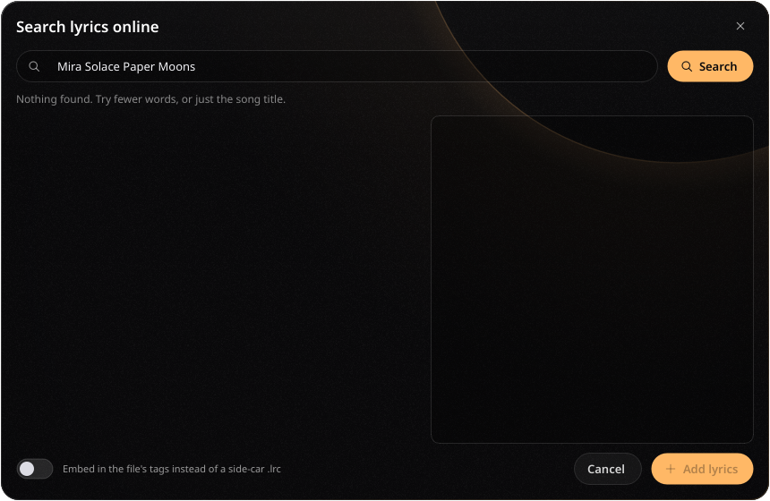<br><sub><b>Search lyrics</b> online and add them</sub></td>
</tr>
<tr>
<td align="center">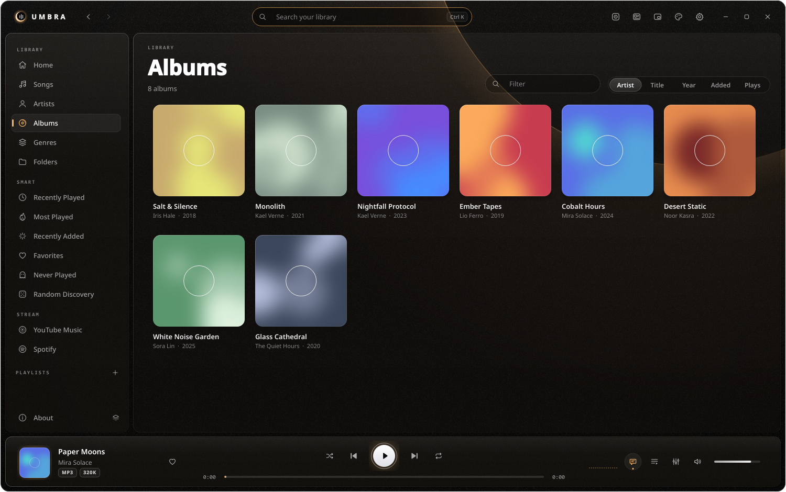<br><sub><b>Albums</b></sub></td>
<td align="center">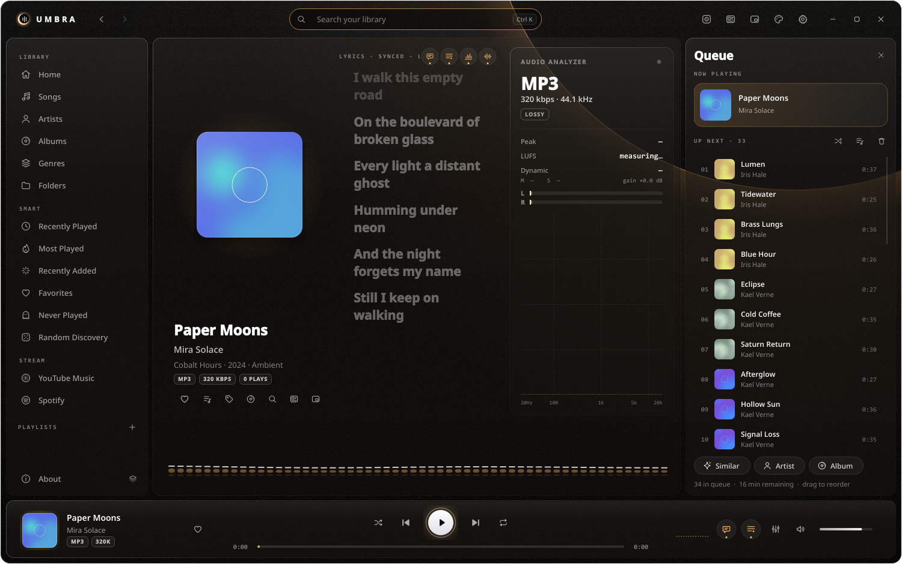<br><sub><b>Queue</b> panel</sub></td>
</tr>
<tr>
<td align="center">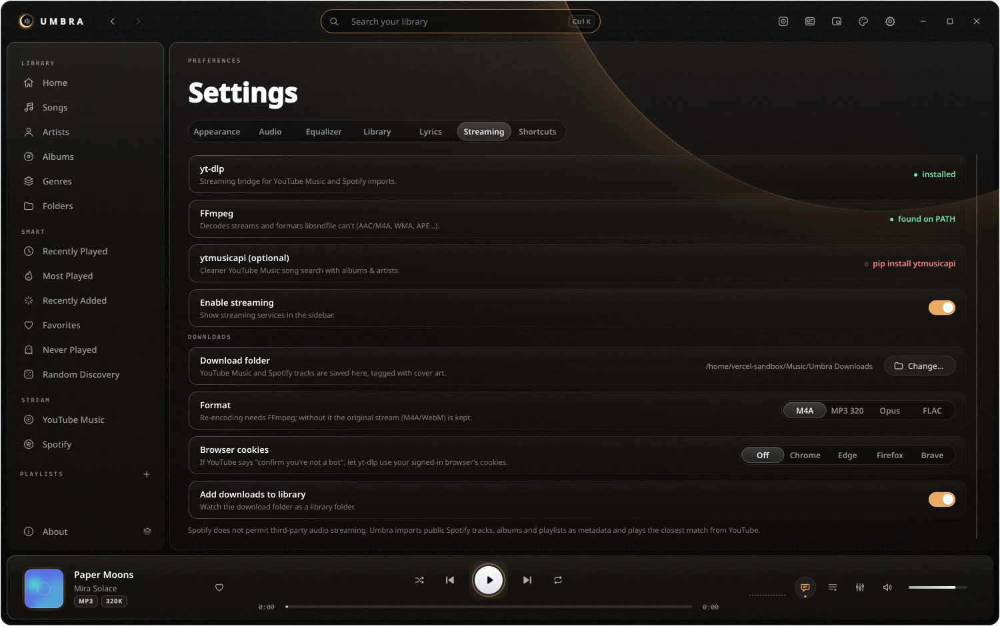<br><sub><b>Settings</b> — streaming & downloads</sub></td>
<td align="center">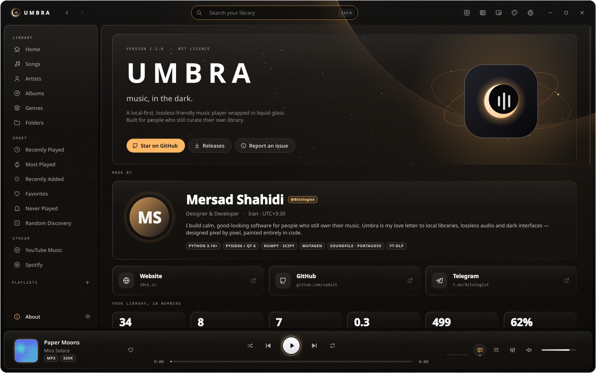<br><sub><b>About</b></sub></td>
</tr>
</table>

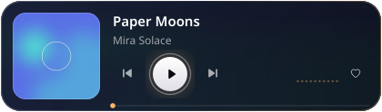
<p><sub><b>Mini player</b> — always on top, out of the way.</sub></p>

</div>

## ✦ Features

<details open>
<summary><b>🎧 Playback & audio engine</b></summary>
<br>

- 64-bit floating-point pipeline with soft limiter
- Gapless playback, crossfade, fades on pause / seek
- 10-band EQ with presets, bass boost and preamp
- Stereo width, balance, mono and channel swap
- Loudness leveling (ReplayGain-style, measured per track)
- WASAPI exclusive mode, output device and buffer selection, high-quality resampling
- Global media keys, tray controls and a **sleep timer** (15–90 min or end of track, with fade-out)

</details>

<details open>
<summary><b>📊 Audio analyzer</b></summary>
<br>

- Codec, bit depth, sample rate, bitrate, channels
- Lossless / lossy / hi-res detection
- True peak, LUFS (momentary, short-term, integrated — EBU R128 / BS.1770) and dynamic range
- Live 20 Hz – 20 kHz spectrum and L/R meters
- Five visualizer styles: Bars, Mirror, Flow, Radial, Scope

</details>

<details open>
<summary><b>🎤 Lyrics</b></summary>
<br>

- Synced `.lrc` side-car files, embedded SYLT / USLT / LYRICS tags or plain text
- Automatic lookup on [LRCLIB](https://lrclib.net) with duration-aware matching
- **Fetch all lyrics** — walks the whole library and saves lyrics as `.lrc`, inside the file, or in Umbra only
- Online search dialog with preview and one-click **Add lyrics**
- Click any line to seek, adjustable size, alignment and sync offset

</details>

<details open>
<summary><b>☁️ Streaming, playlists & downloads</b></summary>
<br>

- YouTube Music search and instant streaming (via yt-dlp)
- Import **Spotify** tracks, albums and playlists, and **YouTube / YouTube Music** playlists
- Save imports as Umbra playlists and **sync** them with the source later
- **Download** single tracks or whole playlists as M4A, MP3 320, Opus or FLAC, tagged with artwork
- Download queue (3 at a time); finished files replace the streams in every playlist and keep plays and favorites
- Optional auto-download of new tracks when a playlist is synced
- Optional Spotify API keys for playlists longer than 100 tracks, browser cookies for YouTube

</details>

<details>
<summary><b>📚 Library & tags</b></summary>
<br>

- Watched folders with automatic rescans
- Songs, albums, artists, genres, folders and playlists (drag & drop, M3U / M3U8 import & export)
- Smart lists: Recently played, Most played, Recently added, Favorites, Never played, Random discovery, Lossless, Hi-Res
- Instant search across everything
- Batch tag editor: all common fields, artwork (file / paste / drag / online), auto-numbering, title case, tags ⇄ filename, rename files

</details>

<details>
<summary><b>🪟 Interface</b></summary>
<br>

- Frameless dark window with glass panels and Windows acrylic blur
- Seven themes — Obsidian, Eclipse, Glacier, Nebula, Verdant, Ember, Sand
- Accent colour from artwork, Windows, wallpaper or your own pick
- Glass density, blur, corner radius, grain, motion, interface scale and compact sidebar — all applied live
- Three player sizes: full window, **Small player** and **Mini player**
- Immersive full-screen Now Playing (F11)

</details>

### Supported formats

| Type | Formats |
|---|---|
| Lossless | FLAC · WAV · AIFF · ALAC\* · APE\* · WavPack\* |
| Lossy | MP3 · AAC / M4A\* · OGG Vorbis · Opus\* · WMA\* |
| Hi-res | 24 / 32-bit at any sample rate your output device supports |
| Lyrics | `.lrc` · SYLT · USLT · LYRICS tag · LRCLIB |
| Playlists | M3U · M3U8 · Spotify links · YouTube links |

<sub>\* decoded through FFmpeg</sub>

## ✦ Install

### Option 1 — download the app

1. Grab **`Umbra-windows.zip`** from the [latest release](https://github.com/sadult/umbra/releases/latest)
2. Extract it anywhere and run **`Umbra.exe`**
3. Recommended: install FFmpeg for AAC / Opus / WMA, streaming and downloads

```powershell
winget install Gyan.FFmpeg
```

### Option 2 — run from source

Requires **Python 3.10+** on Windows 10 / 11.

```powershell
git clone https://github.com/sadult/umbra.git
cd umbra
pip install -r requirements.txt
python main.py
```

Or double-click **`run.bat`** — it creates a virtual environment on first launch.

### Build your own exe

```powershell
build.bat
```

Output: `dist\Umbra\Umbra.exe`. Every push is also built by [GitHub Actions](.github/workflows/build.yml), and every `v*` tag publishes a release automatically.

## ✦ Keyboard shortcuts

| Keys | Action | Keys | Action |
|---|---|---|---|
| <kbd>Space</kbd> | Play / pause | <kbd>Ctrl</kbd> <kbd>L</kbd> | Lyrics on / off |
| <kbd>Ctrl</kbd> <kbd>→</kbd> / <kbd>←</kbd> | Next / previous | <kbd>Ctrl</kbd> <kbd>Q</kbd> | Queue panel |
| <kbd>→</kbd> / <kbd>←</kbd> | Seek ±5 s | <kbd>Ctrl</kbd> <kbd>M</kbd> | Mini player |
| <kbd>Shift</kbd> <kbd>→</kbd> / <kbd>←</kbd> | Seek ±30 s | <kbd>Ctrl</kbd> <kbd>Shift</kbd> <kbd>M</kbd> | Small player |
| <kbd>Ctrl</kbd> <kbd>↑</kbd> / <kbd>↓</kbd> | Volume | <kbd>F11</kbd> | Immersive Now Playing |
| <kbd>M</kbd> | Mute | <kbd>Ctrl</kbd> <kbd>E</kbd> | Edit tags |
| <kbd>Ctrl</kbd> <kbd>K</kbd> | Search | <kbd>Ctrl</kbd> <kbd>D</kbd> | Favorite |
| <kbd>Ctrl</kbd> <kbd>S</kbd> / <kbd>R</kbd> | Shuffle / repeat | <kbd>Ctrl</kbd> <kbd>,</kbd> | Settings |

Media keys work globally. Click the cover in the player bar to open Now Playing — click again to close it.

## ✦ How it works

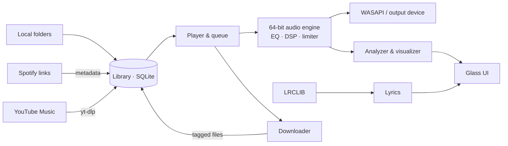

<details>
<summary><b>Project structure</b></summary>

```
umbra/
├── app.py              bootstrap, single instance, tray
├── player.py           queue, playback state, favorites, sleep timer
├── config.py           settings & defaults
├── about_config.py     About page content
├── audio/              decoders, float engine, DSP, EQ, analyzer
├── library/            SQLite library, scanner, tags, lyrics, streaming, downloader
├── ui/                 window, pages, glass widgets, visuals, players, settings, about
├── theme.py            themes & accent extraction
├── winsys.py           Windows blur, media keys, taskbar
└── assets/             app icon
docs/                   banner & screenshots
tools/make_banner.py    renders the README banner
```

Settings, the library database and caches live in `%APPDATA%\Umbra` — never inside the project folder.

</details>

## ✦ FAQ

<details>
<summary><b>YouTube says “Sign in to confirm you're not a bot”.</b></summary>
<br>
Open <i>Settings → Streaming → Browser cookies</i> and choose the browser you're signed in to YouTube with.
</details>

<details>
<summary><b>Only 100 tracks of my Spotify playlist were imported.</b></summary>
<br>
Create a free app at <a href="https://developer.spotify.com/dashboard">developer.spotify.com</a> and paste its Client ID and secret into <i>Settings → Streaming → Spotify API</i>.
</details>

<details>
<summary><b>Does Umbra stream audio from Spotify?</b></summary>
<br>
No. Spotify does not allow third-party audio streaming. Umbra reads public Spotify metadata and plays the closest match from YouTube.
</details>

<details>
<summary><b>Some files don't play / show no duration.</b></summary>
<br>
Install FFmpeg (<code>winget install Gyan.FFmpeg</code>) and restart Umbra. AAC, Opus, WMA and APE are decoded through it.
</details>

<details>
<summary><b>How do I reset Umbra?</b></summary>
<br>
Close the app and delete or rename <code>%APPDATA%\Umbra</code>.
</details>

## ✦ Roadmap

- [x] Synced lyrics, online search and fetch-all
- [x] Spotify & YouTube playlist import, sync and download
- [x] Small player, mini player, sleep timer
- [ ] Last.fm / ListenBrainz scrobbling
- [ ] Discord Rich Presence
- [ ] Smart playlists with custom rules
- [ ] Portable mode (settings next to the exe)
- [ ] Localization

Have an idea? [Open a feature request](https://github.com/sadult/umbra/issues/new/choose).

## ✦ Contributing

Contributions are welcome — bug reports, ideas and pull requests alike. Please read [CONTRIBUTING.md](CONTRIBUTING.md) and the [Code of Conduct](CODE_OF_CONDUCT.md) first.

<a href="https://github.com/sadult/umbra/graphs/contributors"></a>

## ✦ Star history

<a href="https://star-history.com/#sadult/umbra&Date">
  <picture>
    <source media="(prefers-color-scheme: dark)" srcset="https://api.star-history.com/svg?repos=sadult/umbra&type=Date&theme=dark">
    
  </picture>
</a>

## ✦ Built with

[Python](https://www.python.org) · [Qt for Python](https://doc.qt.io/qtforpython/) · [NumPy](https://numpy.org) · [SciPy](https://scipy.org) · [libsndfile](https://libsndfile.github.io/libsndfile/) · [PortAudio](https://www.portaudio.com) · [FFmpeg](https://ffmpeg.org) · [Mutagen](https://github.com/quodlibet/mutagen) · [yt-dlp](https://github.com/yt-dlp/yt-dlp) · [LRCLIB](https://lrclib.net)

## ✦ Author

<table>
<tr>
<td align="center" width="120">
<a href="https://github.com/sadult"></a>
</td>
<td>

**Mersad Shahidi** — [@Bitologist](https://t.me/Bitologist)
Designer & developer

[](https://10ck.ir)
[](https://github.com/sadult)
[](https://t.me/Bitologist)

</td>
</tr>
</table>

If Umbra makes your music sound a little better, consider giving it a ⭐ — it really helps.

## ✦ License

Released under the [MIT License](LICENSE). Download only what you have the right to.

<div align="center">
<br>

<br>
<sub>Made with care, in the dark.</sub>
</div>
